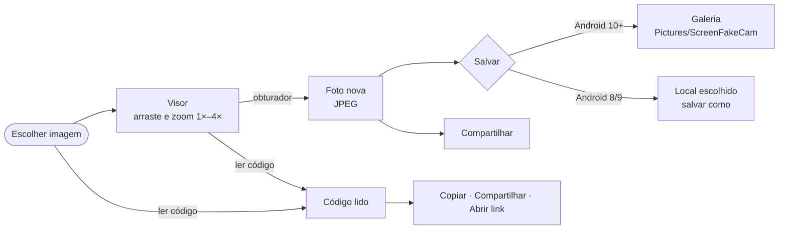
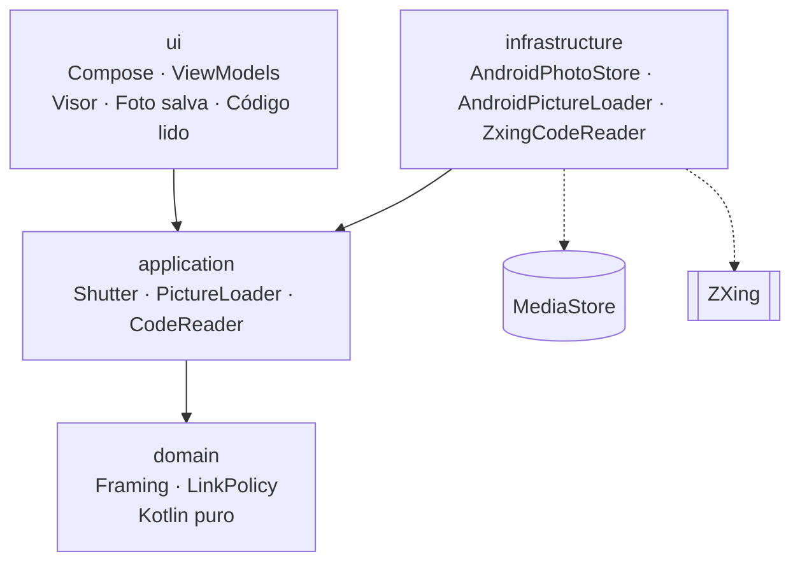

<!-- markdownlint-disable MD033 MD041 -->
<div align="center">

<a href="https://github.com/BrunodosSantosVaz/screenfakecam/releases/tag/v0.3.2">
  
</a>

# ScreenFakeCam

**Sua imagem vira o visor. O obturador cria uma foto nova.**

Aplicativo Android offline para enquadrar uma imagem escolhida, salvar uma nova foto<br>
e ler QR codes e códigos de barras. Kotlin e Jetpack Compose, Android 8+.

<br>

[](https://github.com/BrunodosSantosVaz/screenfakecam/releases)
[](https://github.com/BrunodosSantosVaz/screenfakecam/actions/workflows/bb-ci.yml)
[](https://github.com/BrunodosSantosVaz/screenfakecam/actions/workflows/bb-codeql.yml)
[](LICENSE)
<br>
[](app/src/main/AndroidManifest.xml)
[](gradle/libs.versions.toml)
[](gradle/libs.versions.toml)
[](#-privacidade)

<br>

<a href="https://github.com/BrunodosSantosVaz/screenfakecam/releases/tag/v0.3.2"></a>
<a href="https://github.com/BrunodosSantosVaz/screenfakecam/wiki/Guia-de-inicio"></a>
<a href="https://github.com/BrunodosSantosVaz/screenfakecam/wiki"></a>
<a href="https://github.com/BrunodosSantosVaz/screenfakecam/discussions"></a>

</div>

<!-- Capturas de tela: adicione imagens reais do app em docs/design/screenshots/ e descomente.
<p align="center">
  
  
  
  
</p>
-->

<br>

> [!NOTE]
> O ScreenFakeCam não substitui a câmera de outros aplicativos. Ele funciona apenas dentro dele mesmo.

<details>
<summary><b>Sumário</b></summary>

- [Destaques](#-destaques)
- [Como funciona](#-como-funciona)
- [Leitura de códigos](#-leitura-de-códigos)
- [Instalação](#-instalação)
- [Privacidade](#-privacidade)
- [Arquitetura](#-arquitetura)
- [Desenvolvimento](#-desenvolvimento)
- [Design](#-design)
- [Documentação](#-documentação)
- [Contribuindo](#-contribuindo)
- [Licença](#-licença)

</details>

## 📸 Destaques

<table>
<tr>
<td width="33%" valign="top">

### 🖼️ Imagem como visor
Escolha uma imagem do celular e enquadre com arraste e zoom de 1× a 4×, como numa câmera.

</td>
<td width="33%" valign="top">

### 🔲 Leitor de QR e barras
Leia QR codes e 13 formatos de código de barras direto de uma imagem, inteira ou enquadrada com zoom.

</td>
<td width="33%" valign="top">

### 🔒 100% offline
Sem permissão de internet nem acesso amplo ao armazenamento. Nada sai do seu celular.

</td>
</tr>
</table>

## 🎯 Como funciona



1. **Escolha uma imagem** pelo seletor de fotos do sistema.
2. **Enquadre** arrastando com o dedo e use dois dedos ou os botões para o zoom. Com teclado, use as setas e as teclas <kbd>+</kbd> e <kbd>−</kbd>.
3. **Toque no obturador.** O app salva um novo JPEG com exatamente o que o visor mostra.
4. **Compartilhe** a foto ou tire outra.

> [!TIP]
> A imagem original nunca é alterada. Cada foto é um arquivo novo, chamado `ScreenFakeCam_AAAAMMDD_HHMMSS.jpg`.

## 🔲 Leitura de códigos

Leitura offline com [ZXing](https://github.com/zxing/zxing), com duas estratégias de binarização para fotos com luz irregular e códigos pequenos.

| 2D | 1D |
|---|---|
|     |          |

O texto lido pode ser copiado ou compartilhado. **Abrir link** só aparece para endereços `http` e `https`. Esquemas como `javascript:`, `intent://`, `file://` e `content://` nunca são abertos.

## 📲 Instalação

<a href="https://github.com/BrunodosSantosVaz/screenfakecam/releases/tag/v0.3.2"></a>

1. Baixe o APK assinado em [Releases](https://github.com/BrunodosSantosVaz/screenfakecam/releases).
2. Abra o arquivo no celular e permita a instalação de fontes desconhecidas, se o sistema pedir.
3. Abra o **ScreenFakeCam** e escolha uma imagem.

| Requisito | Valor |
|---|---|
| Sistema | Android 8.0 (Oreo) ou mais recente |
| Permissões | Nenhuma permissão perigosa |
| Internet | Não usa |

Detalhes na [Wiki → Instalação e uso](https://github.com/BrunodosSantosVaz/screenfakecam/wiki/Guia-de-inicio).

## 🔐 Privacidade

- **Sem internet.** O manifesto não declara a permissão `INTERNET`.
- **Sem acesso amplo ao armazenamento.** A imagem vem do seletor de fotos do sistema, e a foto vai para a galeria pelo MediaStore.
- **Sem backup automático** dos dados do app.
- Um teste falha se alguma permissão for adicionada ao manifesto.

## 🏛️ Arquitetura

Camadas verificadas por testes de arquitetura com Konsist.



| Camada | Responsabilidade |
|---|---|
| `domain` | Enquadramento imutável (zoom 1×–4×, arraste limitado à borda, região visível) e política de links |
| `application` | Obturador, carregamento da imagem e contrato do leitor de códigos |
| `infrastructure` | Gravação em JPEG no MediaStore, leitura da imagem com EXIF e leitor ZXing |
| `ui` | Telas em Jetpack Compose, ViewModels e tema |

<details>
<summary><b>Stack completa</b></summary>

| Camada | Tecnologia |
|---|---|
| Linguagem | Kotlin 2.4 |
| UI | Jetpack Compose · Material 3 |
| Build | Android Gradle Plugin 9.4 · Gradle Wrapper · dependências travadas |
| Imagem | AndroidX ExifInterface |
| Códigos | ZXing core 3.5 |
| Testes | JUnit · Robolectric · Compose UI Test · Konsist |
| Qualidade | Android Lint · ktlint · Kover (cobertura mínima de 80%) |

</details>

## 🛠️ Desenvolvimento

**Pré-requisitos:** JDK e Android SDK (pelo Android Studio ou pelo ambiente de CI).

```bash
git clone https://github.com/BrunodosSantosVaz/screenfakecam.git
cd screenfakecam
./gradlew assembleDebug
```

| Comando | O que faz |
|---|---|
| `./gradlew assembleDebug` | Gera o APK de desenvolvimento |
| `./gradlew testDebugUnitTest` | Testes unitários |
| `./gradlew testDebugUnitTest --tests 'aceite.*'` | Testes de aceite |
| `./gradlew testDebugUnitTest --tests 'arquitetura.*'` | Regras de arquitetura |
| `./gradlew koverVerifyDebug` | Cobertura mínima |
| `./gradlew lint ktlintCheck` | Lint e estilo |
| `./gradlew assembleRelease` | APK de release |

<details>
<summary><b>Build assinado da esteira</b></summary>

`packaging/android/build.sh` gera exatamente um APK assinado. O keystore existe só num arquivo temporário durante o build.

| Variável | Uso |
|---|---|
| `BB_VERSAO` | Versão esperada, conferida com `version.properties` |
| `BB_ASSINATURA_ARQUIVO` | Keystore em base64 |
| `BB_ASSINATURA_SENHA` · `BB_ASSINATURA_ALIAS` · `BB_ASSINATURA_SENHA_CHAVE` | Credenciais de assinatura |

</details>

## 🎨 Design

| Token | Cor | Uso |
|---|:-:|---|
| Fundo |  `#000000` | Visor e fundo das telas |
| Superfície |  `#1C1C1E` | Barras, folhas e cartões |
| Superfície 2 |  `#2C2C2E` | Botões secundários |
| Primária |  `#FFC107` | Obturador, seleção e ícone |
| Sucesso |  `#4ADE80` | Confirmações |
| Erro |  `#FF6B6B` | Falhas |

Toque mínimo de 48 dp e obturador de 76 dp. Tokens em [`docs/design/tokens.css`](docs/design/tokens.css), espelhados no tema Compose. Identidade na [Wiki → Design](https://github.com/BrunodosSantosVaz/screenfakecam/wiki/Design).

## 📚 Documentação

A documentação oficial está na **[Wiki](https://github.com/BrunodosSantosVaz/screenfakecam/wiki)**.

| | |
|---|---|
| 🚀 [Instalação e uso](https://github.com/BrunodosSantosVaz/screenfakecam/wiki/Guia-de-inicio) | ✨ [Funcionalidades e limites](https://github.com/BrunodosSantosVaz/screenfakecam/wiki/Funcionalidades) |
| 🏛️ [Arquitetura e referência](https://github.com/BrunodosSantosVaz/screenfakecam/wiki/Referencia) | 🔧 [Operação e recuperação](https://github.com/BrunodosSantosVaz/screenfakecam/wiki/Operacao) |
| 🔗 [Requisitos e cobertura documental](https://github.com/BrunodosSantosVaz/screenfakecam/wiki/Rastreabilidade) | 👋 [Boas-vindas da IA](https://github.com/BrunodosSantosVaz/screenfakecam/discussions/93) |

**Painéis públicos:** [Planejamento](https://github.com/users/BrunodosSantosVaz/projects/22) · [Execução](https://github.com/users/BrunodosSantosVaz/projects/23) · [Bugs](https://github.com/users/BrunodosSantosVaz/projects/24). Edição exige permissão explícita.

## 🤝 Contribuindo

Construído com o framework [Big Bang](https://github.com/BrunodosSantosVaz/big-bang) 2.0.1, no modo **Flash**.

1. Relate bugs e ideias nas [issues](https://github.com/BrunodosSantosVaz/screenfakecam/issues). Dúvidas vão para [Discussions](https://github.com/BrunodosSantosVaz/screenfakecam/discussions).
2. Trabalhe numa branch própria e preserve os testes de aceite.
3. Envie o PR com `Refs #n`, descrição, evidências e a Wiki atualizada.

Veja o [guia de contribuição](CONTRIBUTING.md), a [política de segurança](SECURITY.md) e o [código de conduta](CODE_OF_CONDUCT.md).

## 📄 Licença

Distribuído sob a licença [GPL-3.0](LICENSE).

<div align="center">

<br>


<sub>Por <a href="https://github.com/BrunodosSantosVaz">Bruno dos Santos Vaz</a></sub>

<br><br>

<a href="https://star-history.com/#BrunodosSantosVaz/screenfakecam&Date">
  
</a>

<br>

<sub>Curtiu o ScreenFakeCam? Deixe uma ⭐ no repositório.</sub>

</div>
